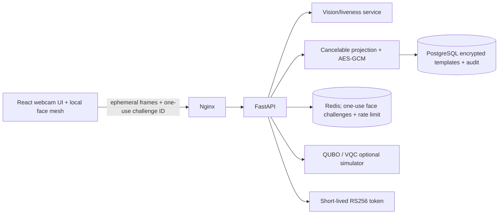

# Architecture

The browser's face-mesh model runs locally and draws a live guide. The API accepts base64 frame payloads but deliberately does not persist them. Deployments should terminate TLS at the proxy and set restrictive CORS origins.
